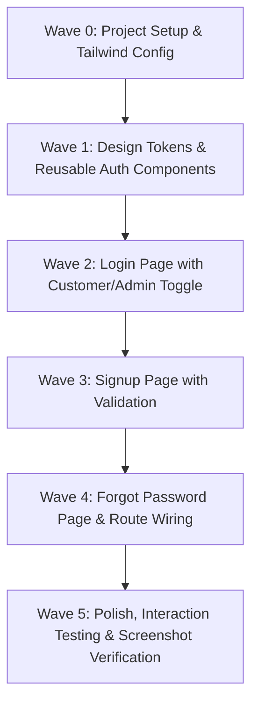

# 🎮 Oliveal Gaming Zone — Authentication Module Plan
### Phase 1: Frontend Implementation Plan (GSD & UI/UX Pro Specification)

---

## 1. Executive Summary & Design Alignment

This plan defines the architecture, visual design system, component hierarchy, and execution roadmap for the **Oliveal Gaming Zone Authentication Module**. 

The design is strictly derived from the uploaded reference image, adhering to the **UI/UX Pro** visual quality standard and the **GSD (Get Shit Done)** phased verification methodology.

```
Reference Target: media_1794227459378_5881282e.jpg
Visual Identity: Cyberpunk / Premium Esports Gaming Atmosphere
Primary Palette: Deep Midnight Black/Navy (#060509 / #0D0B18) + Neon Violet & Fuchsia Glow (#A855F7, #9333EA)
Approach: Mobile-First Responsive React (Vite) + Tailwind CSS + Lucide Icons
```

---

## 2. Visual Design Contract & Design Tokens (UI/UX Pro)

### 🎨 Color Palette & Lighting
| Token Name | Hex / Class | Purpose |
|---|---|---|
| **Base Surface** | `#07060D` (`bg-[#07060D]`) | Darkest canvas background |
| **Card Surface** | `rgba(18, 15, 32, 0.75)` | Translucent glass container (`backdrop-blur-xl`) |
| **Input Surface** | `rgba(26, 22, 46, 0.85)` | Deep recessed input field background |
| **Border Subtle** | `rgba(255, 255, 255, 0.08)` | Resting field and card borders |
| **Border Accent** | `rgba(168, 85, 247, 0.4)` | Active / focus border highlight |
| **Neon Violet (Primary)** | `#A855F7` (`purple-500`) | Main accent, controller glow, icons |
| **Deep Violet** | `#7C3AED` (`purple-600`) | Gradient start / active tabs |
| **Electric Fuchsia** | `#D946EF` (`fuchsia-500`) | Edge ambient glow highlights |
| **Text Primary** | `#FFFFFF` | Headings, active values, button labels |
| **Text Secondary** | `#94A3B8` (`slate-400`) | Subtitles, input placeholders, labels |
| **Text Muted** | `#64748B` (`slate-500`) | Dividers, hints, disabled state |

### ✨ Shadows & Glow Effects
- **Primary Button Glow:** `box-shadow: 0 4px 20px -2px rgba(168, 85, 247, 0.5), 0 0 15px 0 rgba(147, 51, 234, 0.3)`
- **Card Glass Border:** `box-shadow: 0 8px 32px 0 rgba(0, 0, 0, 0.6), inset 0 1px 0 rgba(255, 255, 255, 0.1)`
- **Focused Input Ring:** `box-shadow: 0 0 0 2px rgba(168, 85, 247, 0.3), 0 0 12px rgba(168, 85, 247, 0.2)`
- **Controller Ambient Glow:** Layered radial gradients simulating neon tubes behind the hardware silhouette.

### 📐 Typography & Hierarchy
- **Heading 1 ("Welcome Back", "Create Account"):** 26px / 1.2 line-height, `font-bold`, crisp white.
- **Brand Wordmark ("Oliveal"):** 24px, stylized tracking, semi-italic/bold with "GAMING ZONE" in 10px tracking (`tracking-[0.3em]`) uppercase.
- **Field Labels:** 13px, `font-medium`, `#CBD5E1` (`slate-300`).
- **Input Text:** 14px, regular, `#FFFFFF`, with `#64748B` placeholder.
- **Button Text:** 15px, `font-semibold`, tracking wide, with interactive arrow transition.

---

## 3. Page Specifications

### 📱 A. Customer Login Page (`/login`)
1. **Background Atmosphere:**
   - Deep gaming room aesthetic with ambient neon violet lighting curves.
   - Ambient PS5/Xbox gaming controller resting at bottom surface with soft violet edge lights.
   - Top-right subtle neon controller wall glyph.
2. **Branding Header:**
   - SVG neon line-art controller icon with violet halo.
   - "Oliveal" logo + "GAMING ZONE" sub-label.
3. **Title & Subtitle:**
   - "Welcome Back" (h1)
   - "Login to your account" (subtitle in slate-400)
4. **Segmented Role Selector:**
   - Pill toggle: **Customer** (default active with violet glow) vs **Admin** (inactive outline).
   - Instant UI mode toggle without page reload.
5. **Interactive Form:**
   - **Email Address** field (with `Mail` icon).
   - **Password** field (with `Lock` icon and `Eye` / `EyeOff` visibility toggle).
   - **Options Row:**
     - Left: Custom checkbox "Remember me" with neon purple check state.
     - Right: "Forgot Password?" hyperlink leading to `/forgot-password`.
6. **Action Buttons:**
   - **"Log In →"** primary CTA: Full width gradient button (`from-purple-600 to-fuchsia-600`), neon glow, loading spinner state support.
   - **Divider:** Subtle gradient lines with `"or continue with"` center label.
   - **"Continue with Google"**: Sleek dark border pill button with official multicolored Google "G" icon.
7. **Footer Navigation:**
   - `"Don't have an account? Sign Up"` (purple accented link to `/signup`).

### 🛡️ A-2. Admin Login Variant (Triggered via Role Selector)
- **Role Switch Behavior:** Clicking "Admin" immediately transforms the login card context.
- **Visual Distinction:** Role indicator shows shield badge `Admin Portal`.
- **Enforced Business Rules:**
  - Google OAuth button is **hidden** (Admins authenticate strictly via enterprise credentials).
  - "Don't have an account? Sign Up" is replaced with `"Admin accounts are securely provisioned by server admins"`.
  - Primary button updates to `"Admin Log In →"`.

### 📱 B. Customer Signup Page (`/signup`)
1. **Top Header Bar:**
   - Circular glass back button (`ArrowLeft`) to return to `/login`.
   - Oliveal Gaming Zone branding.
2. **Title:**
   - "Create Account" (h1).
3. **Role Selector Handling (Strict Business Rule Enforcement):**
   - In accordance with the prompt's business rule, **Admin registration is strictly prohibited**.
   - Signup UI only accepts customer registrations. "Customer" is locked/active with an informative micro-badge confirming customer registration.
4. **Signup Form Fields:**
   - **Full Name** input (`User` icon).
   - **Email Address** input (`Mail` icon).
   - **Password** input (`Lock` icon + visibility toggle).
   - **Confirm Password** input (`Lock` icon + visibility toggle + password match validation).
5. **Action Buttons:**
   - **"Sign Up →"** primary gradient button with subtle glow and hover elevation.
   - Submitting the valid form transitions directly to the **6-Digit OTP Verification Screen / Popup**.
   - **Divider:** `"or continue with"`.
   - **"Continue with Google"** social signup button.
6. **Footer Navigation:**
   - `"Already have an account? Log In"` (link back to `/login`).

### 🔢 B-2. 6-Digit OTP Verification Page / Modal (`/verify-otp` or popup overlay)
1. **Visual Atmosphere & Layout:**
   - Premium glassmorphism card container with glowing neon purple ambient backdrop.
   - Glowing security verification badge / Mail shield icon with soft purple pulse.
2. **Header & Contextual Copy:**
   - "Verify Your Email" (h1)
   - "We have sent a 6-digit verification code to **user@example.com**"
3. **6-Digit Input Matrix:**
   - 6 distinct rounded square/pill input blocks (`w-12 h-14` or `w-11 h-13` mobile-optimized).
   - Auto-focus on first digit on load.
   - Auto-advance to next input on character entry.
   - Backspace auto-reverses focus to previous input.
   - Full clipboard paste support (e.g. copying "849201" instantly populates all 6 boxes).
   - Active digit has vivid purple neon ring (`ring-2 ring-purple-500 shadow-[0_0_15px_rgba(168,85,247,0.4)]`).
4. **Resend Timer & Micro-interactions:**
   - Live 60-second countdown timer ("Resend code in 00:45").
   - Interactive `"Resend Code"` link enabled once timer elapses.
5. **Action Buttons:**
   - **"Verify & Continue →"** primary gradient button with loading state.
   - `"Wrong email? Change Email Address"` navigation link returning to edit details.
6. **Success State:**
   - Micro-interaction checkmark animation and simulated redirect to the application main hub.

### 📱 C. Forgot Password Page (`/forgot-password`)
1. **Header:** Circular glass back button + Oliveal branding.
2. **Title & Copy:**
   - "Reset Password"
   - "Enter your registered email address and we'll send a password reset link."
3. **Form:**
   - Email Address field (`Mail` icon).
   - **"Send Reset Link →"** primary gradient button.
   - Interactive feedback simulation (success banner upon submission: *"Check your inbox for reset instructions"*).
4. **Footer:**
   - `"Remember your password? Log In"`.

---

## 4. Component Architecture

```
src/
├── assets/
│   ├── images/
│   │   └── gaming-controller.png      # High-res gamepad asset
│   └── icons/
│       └── GoogleIcon.jsx             # Clean SVG Google "G" logo
├── components/
│   ├── auth/
│   │   ├── AuthLayout.jsx             # Atmospheric background wrapper + glass container
│   │   ├── AuthBranding.jsx           # Neon controller logo + Oliveal Gaming Zone typography
│   │   ├── RoleSelector.jsx           # Customer / Admin animated pill toggle
│   │   ├── AuthInput.jsx              # Reusable dark glass input with icon & validation state
│   │   ├── PasswordInput.jsx          # Input with toggleable eye icon
│   │   ├── PrimaryButton.jsx          # Gradient button with glow, spinner & arrow animation
│   │   └── SocialLoginButton.jsx      # Google OAuth pill button
│   └── ui/
│       ├── Checkbox.jsx               # Custom purple-themed checkbox
│       └── StatusMessage.jsx          # Animated alert banner (success/error/info)
├── pages/
│   └── auth/
│       ├── Login.jsx                  # Unified Customer & Admin login page
│       ├── Signup.jsx                 # Customer registration page
│       ├── OtpVerification.jsx        # 6-Digit OTP verification modal/page
│       └── ForgotPassword.jsx         # Password recovery page
├── routes/
│   └── AppRoutes.jsx                  # React Router configuration
├── App.jsx                            # Root application component
├── index.css                          # Tailwind custom utilities & ambient glow effects
└── main.jsx                           # Application entrypoint
```

---

## 5. Responsive Design & Mobile-First Strategy

1. **Mobile Viewport (360px – 480px):**
   - Natural viewport height adaptation (`min-h-screen`, `pb-8`).
   - Clean spacing (`px-4`, `py-6`) avoiding overflow.
   - Ergonomic thumb-zone buttons (minimum 48px height for all touch targets).
   - Background controller art positioned gracefully without obscuring form fields.
2. **Desktop / Tablet Viewport (>768px):**
   - Content centered in a focused glassmorphism device container (max-w-md, 440px width).
   - Ambient gaming room glow subtly expanded across the full desktop background.
   - Maintains exact mobile app fidelity for testing and multi-device usability.

---

## 6. Implementation Work Breakdown (GSD Waves)



### Wave 0 — Scaffolding & Configuration
- Initialize Vite + React project in the current working directory.
- Install dependencies: `react-router-dom`, `lucide-react`, `tailwindcss`, `postcss`, `autoprefixer`.
- Configure `tailwind.config.js` with Oliveal neon palette, custom glow shadows, and font settings.
- Implement background ambient shaders and gaming atmosphere assets.

### Wave 1 — Reusable Atomic & Molecule Components
- Build `AuthLayout`: Deep dark atmosphere with ambient neon gradients, subtle controller graphics, and glass card wrapper.
- Build `AuthBranding`: Vector gaming controller icon with neon glow + stylized "Oliveal GAMING ZONE".
- Build `RoleSelector`: Smooth tab control between Customer and Admin.
- Build `AuthInput` & `PasswordInput`: Rounded glass input fields with icons, focus states, and visibility toggles.
- Build `PrimaryButton` & `SocialLoginButton`: Gradient glow buttons with hover/active transitions.

### Wave 2 — Customer & Admin Login Page (`/login`)
- Assemble login screen matching left side of reference image.
- Implement Customer/Admin toggle logic (switches between customer view and admin portal mode).
- Implement field validation (email format, password required).
- Implement simulated loading and feedback states.

### Wave 3 — Customer Signup Page (`/signup`) & 6-Digit OTP Flow
- Assemble registration screen matching right side of reference image.
- Enforce business rule: Customer-only account creation (no admin registration).
- Add full name, email, password, and confirm password with real-time match validation.
- Implement **6-Digit OTP Verification** interface (`OtpVerification.jsx`):
  - 6 individual digit inputs with auto-focus, digit progression, backspace recovery, and clipboard paste.
  - 60-second countdown timer for resend code.
  - Interactive verify button and success feedback.
- Implement back-button navigation to login.

### Wave 4 — Forgot Password Page (`/forgot-password`) & Navigation
- Build password recovery flow with instructions and success confirmation state.
- Wire all routes (`/`, `/login`, `/signup`, `/forgot-password`) in `AppRoutes.jsx`.

### Wave 5 — Verification & Visual Parity Check
- Verify visual parity against `media_1794227459378_5881282e.jpg`.
- Test responsive viewports across mobile (375px, 414px) and desktop.
- Verify zero console errors, smooth tab transitions, and accessible focus states.
