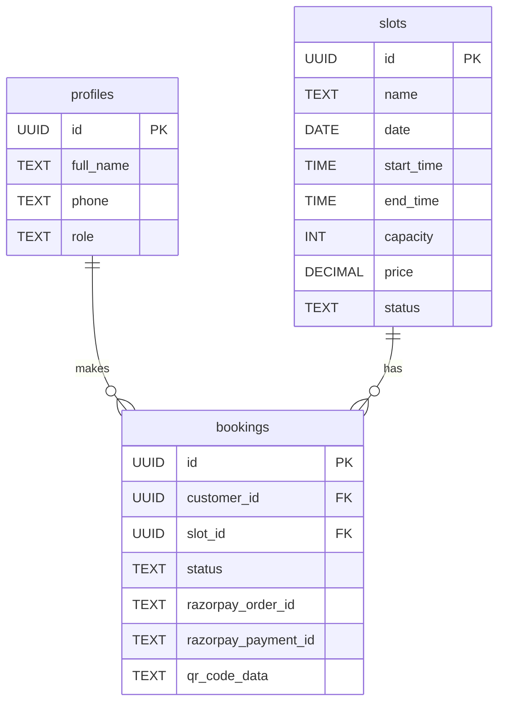
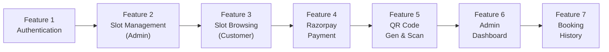

# 🎮 Oliveal Gaming Zone — Implementation Plan

> Mobile-first Web App | React + Supabase | Feature-by-Feature Approach

---

## 🏗️ Tech Stack

| Layer | Technology |
|---|---|
| Frontend | React (Vite) + TailwindCSS |
| Backend / DB | Supabase (Auth, PostgreSQL, Storage, Edge Functions) |
| Payments | Razorpay |
| QR Code | `qrcode.react` (generate) + `html5-qrcode` (scan) |
| Routing | React Router v6 |
| State | Zustand or React Context |
| Hosting | Vercel / Netlify |

---

## 👥 User Roles

| Role | Sign Up | Login |
|---|---|---|
| **Customer** | Email + Password or Google OAuth | ✅ |
| **Admin** | ❌ (credentials created server-side) | Email + Password only |

---

## 🗂️ Feature Roadmap

```
Feature 1 → Authentication
Feature 2 → Slot Management (Admin)
Feature 3 → Slot Browsing & Booking (Customer)
Feature 4 → Razorpay Payment Gateway
Feature 5 → QR Code Generation & Scanning
Feature 6 → Admin Dashboard
Feature 7 → Customer Booking History
Feature 8 → Notifications (optional)
```

---

## 📦 Feature 1 — Authentication

### 1A. Frontend Pages
- `/login` — Email/password form + Google OAuth button
- `/signup` — Email/password + name form (customers only)
- `/admin/login` — Separate admin login page (no signup link)
- Route guards: `ProtectedRoute` (customer), `AdminRoute` (admin)
- Mobile-first responsive design

### 1B. Database & Backend (Supabase)
```sql
-- Supabase handles auth.users automatically
-- Custom profiles table
CREATE TABLE profiles (
  id UUID REFERENCES auth.users(id) PRIMARY KEY,
  full_name TEXT,
  phone TEXT,
  role TEXT DEFAULT 'customer' CHECK (role IN ('customer', 'admin')),
  created_at TIMESTAMPTZ DEFAULT NOW()
);

-- RLS: users can only read/write their own profile
```
- Enable **Email/Password** provider in Supabase Auth
- Enable **Google OAuth** provider (configure OAuth app in Google Console)
- Admin account created via Supabase Dashboard / seed script (role = `'admin'`)
- `profiles` table auto-populated via DB trigger on new user signup

### 1C. Frontend Integration
- `supabase.auth.signUp()` → customer registration
- `supabase.auth.signInWithPassword()` → email login
- `supabase.auth.signInWithOAuth({ provider: 'google' })` → Google login
- Read `profiles.role` after login → redirect to `/dashboard` or `/admin/dashboard`
- Persist session with Supabase's built-in session management

---

## 📦 Feature 2 — Slot Management (Admin)

### 2A. Frontend Pages
- `/admin/slots` — View all slots (table/card view)
- `/admin/slots/create` — Create new slot form
- `/admin/slots/[id]/edit` — Edit slot
- Slot fields: `name`, `date`, `start_time`, `end_time`, `capacity`, `price`, `status`

### 2B. Database
```sql
CREATE TABLE slots (
  id UUID DEFAULT gen_random_uuid() PRIMARY KEY,
  name TEXT NOT NULL,              -- e.g. "PS5 Station 1"
  description TEXT,
  date DATE NOT NULL,
  start_time TIME NOT NULL,
  end_time TIME NOT NULL,
  capacity INT DEFAULT 1,
  price DECIMAL(10,2) NOT NULL,
  status TEXT DEFAULT 'available' CHECK (status IN ('available', 'booked', 'disabled')),
  created_at TIMESTAMPTZ DEFAULT NOW()
);

-- RLS: only admin can INSERT/UPDATE/DELETE; anyone can SELECT available slots
```

### 2C. Frontend Integration
- CRUD operations via Supabase client (`insert`, `update`, `delete`)
- Real-time slot status updates using Supabase Realtime subscriptions

---

## 📦 Feature 3 — Slot Browsing & Booking (Customer)

### 3A. Frontend Pages
- `/slots` — Browse available slots (filterable by date)
- `/slots/[id]` — Slot detail page
- `/booking/[slotId]` — Booking confirmation page (pre-payment)

### 3B. Database
```sql
CREATE TABLE bookings (
  id UUID DEFAULT gen_random_uuid() PRIMARY KEY,
  customer_id UUID REFERENCES profiles(id),
  slot_id UUID REFERENCES slots(id),
  status TEXT DEFAULT 'pending' CHECK (status IN ('pending', 'confirmed', 'cancelled', 'used')),
  razorpay_order_id TEXT,
  razorpay_payment_id TEXT,
  qr_code_data TEXT,          -- unique token for QR
  booked_at TIMESTAMPTZ DEFAULT NOW(),
  confirmed_at TIMESTAMPTZ
);
```

### 3C. Frontend Integration
- Fetch available slots → `supabase.from('slots').select('*').eq('status', 'available')`
- Customer selects slot → create `pending` booking record → proceed to payment

---

## 📦 Feature 4 — Razorpay Payment Gateway

### 4A. Frontend
- Load Razorpay checkout script dynamically
- On payment success → capture `razorpay_payment_id` and verify server-side
- Show success / failure screen

### 4B. Backend (Supabase Edge Functions)
```
/functions/create-razorpay-order   → creates order via Razorpay API
/functions/verify-razorpay-payment → verifies signature, confirms booking
```

**Payment Flow:**
```
Customer clicks "Book Now"
     ↓
Edge Fn: create-razorpay-order (returns order_id)
     ↓
Razorpay Checkout opens in browser
     ↓
Customer pays
     ↓
Edge Fn: verify-razorpay-payment (HMAC signature check)
     ↓
booking.status → 'confirmed'
slot.status    → 'booked'
qr_code_data   → generated unique token stored in booking
```

> [!IMPORTANT]
> Never expose Razorpay `key_secret` on the frontend. All order creation and payment verification must happen in Supabase Edge Functions (server-side).

---

## 📦 Feature 5 — QR Code Generation & Scanning

### 5A. QR Generation (Customer)
- After confirmed payment → generate QR code from `booking.qr_code_data` (a UUID token)
- `/booking/[id]/confirmation` page displays the QR code
- Customer can also access it from booking history

### 5B. QR Scanning (Admin)
- `/admin/scan` — Camera-based QR scanner page
- Scan → extract token → lookup booking in Supabase
- Validate: `status === 'confirmed'` and correct date/slot
- If valid → update `booking.status = 'used'`
- Show green (valid) or red (invalid/used) result

### 5C. Frontend Integration
- `qrcode.react` → renders QR as SVG/Canvas
- `html5-qrcode` → accesses device camera for scanning

---

## 📦 Feature 6 — Admin Dashboard

### 6A. Frontend Pages
- `/admin/dashboard` — Overview cards (today's bookings, revenue, slot utilization)
- `/admin/bookings` — All bookings with filters (date, status)
- `/admin/scan` — QR scanner

### 6B. Data
- Aggregate queries via Supabase for stats
- Realtime subscription for live booking updates

---

## 📦 Feature 7 — Customer Booking History

### 7A. Frontend Pages
- `/my-bookings` — List of past and upcoming bookings
- `/my-bookings/[id]` — Booking detail + QR code display

### 7B. Data
- Fetch `bookings` filtered by `customer_id = auth.uid()`
- RLS ensures customers only see their own bookings

---

## 🗄️ Database Schema Overview



---

## 🔐 Row Level Security (RLS) Summary

| Table | Customer | Admin |
|---|---|---|
| `profiles` | Read/write own row | Read all |
| `slots` | Read available | Full CRUD |
| `bookings` | Read/write own | Read all, update status |

---

## 📁 Project Structure

```
oliveal-gaming-zone/
├── public/
├── src/
│   ├── components/
│   │   ├── ui/            # Reusable UI (Button, Card, Modal)
│   │   ├── auth/          # Login, Signup forms
│   │   ├── slots/         # SlotCard, SlotList, SlotForm
│   │   ├── booking/       # BookingCard, QRDisplay
│   │   └── admin/         # AdminNav, Scanner
│   ├── pages/
│   │   ├── auth/          # Login.jsx, Signup.jsx
│   │   ├── customer/      # Slots.jsx, BookingConfirmation.jsx, MyBookings.jsx
│   │   └── admin/         # Dashboard.jsx, SlotManagement.jsx, Scanner.jsx
│   ├── hooks/             # useAuth, useSlots, useBooking
│   ├── lib/
│   │   ├── supabase.js    # Supabase client init
│   │   └── razorpay.js    # Razorpay helpers
│   ├── store/             # Zustand stores
│   └── App.jsx
├── supabase/
│   ├── migrations/        # SQL migration files
│   └── functions/         # Edge Functions
│       ├── create-razorpay-order/
│       └── verify-razorpay-payment/
└── .env
```

---

## 🚀 Build Order



---

## ⚙️ Environment Variables

```env
VITE_SUPABASE_URL=
VITE_SUPABASE_ANON_KEY=
VITE_RAZORPAY_KEY_ID=
# Server-side only (Edge Functions):
RAZORPAY_KEY_SECRET=
RAZORPAY_WEBHOOK_SECRET=
```

---

> [!TIP]
> Start Feature 1 (Auth) first — every other feature depends on the authenticated user context. Use Supabase's built-in email confirmation for customer signups and skip it for the admin seed account.

